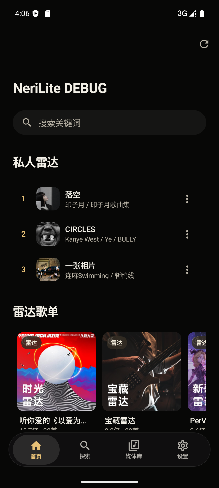
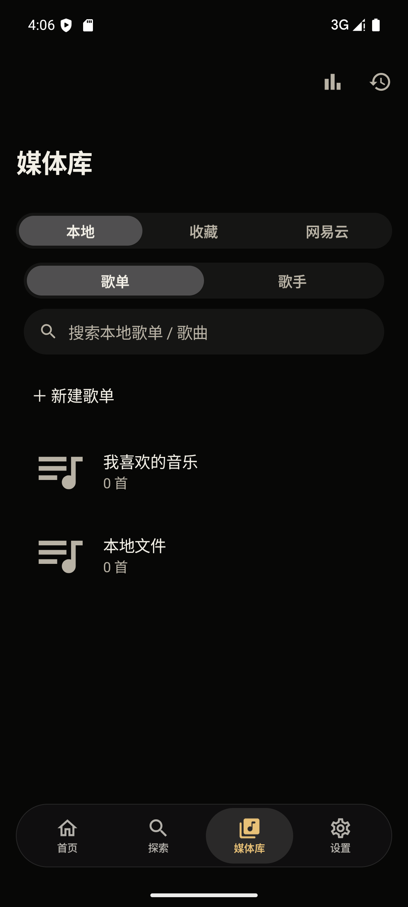
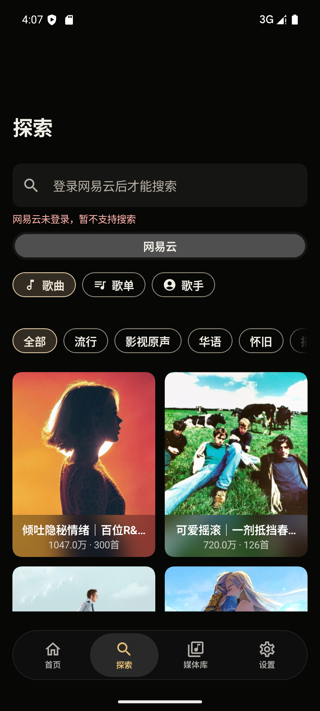
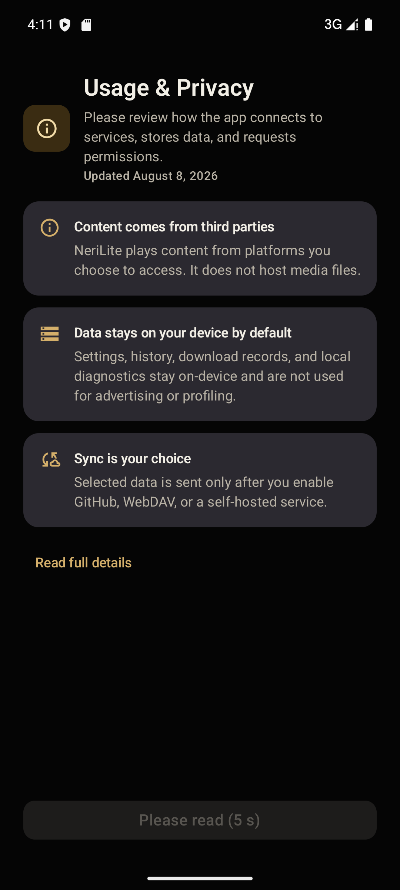
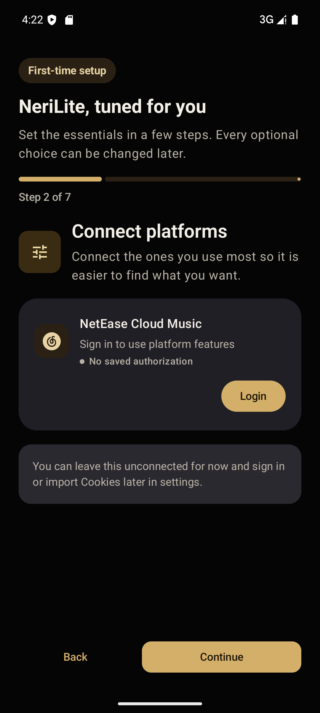
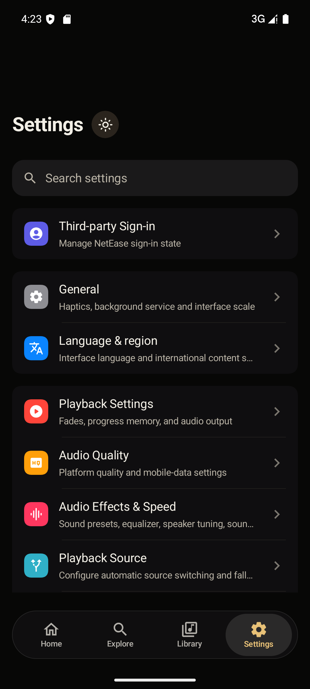

# Gramophone 开发记录

> 本文件是 NeriPlayer → Gramophone 精简分支的长期开发文档。
> 每次改动请更新「改动记录」和「下一步」，不要只依赖聊天记录。

---

## 1. 项目方向

### 已确定路线

**在 NeriPlayer 基础上做 Lite 分支，不从头重写。**

原因：

- NeriPlayer 是原生 Android（Kotlin + Jetpack Compose + Media3），播放、缓存、下载、歌词、音效已经成熟。
- 网易云协议层、登录、播放地址解析、歌词接口都已实现，重写成本高。
- 需要保留：网易云、本地音乐、下载/离线、歌词、10 段 EQ/音效。
- 需要去掉：Bilibili、YouTube Music、Subsonic 音乐服务器、一起听、GitHub/WebDAV 同步等非核心入口。
- 需要改善：默认视觉（黑金 / Walkman 风格）、动画流畅度、后台负担。

### 不换语言

继续使用 **Kotlin + Jetpack Compose**。

- 复用现有模块的前提就是 Kotlin。
- Compose 可以做高刷新率原生动画。
- 换 Flutter/React Native 会引入额外渲染层，音频延迟和动画成本更高，也无法直接复用现有模块。
- 卡顿主要来自模糊、流体背景、玻璃效果和高频重组，不是 Kotlin 本身。

---

## 2. 功能边界（v0.1）

保留：

- 网易云扫码登录 / Cookie 持久化
- 首页：每日推荐、推荐歌单、私人 FM、私人雷达
- 搜索：歌曲 / 歌单 / 歌手
- 歌单、专辑、歌手详情
- 播放页：封面、进度、队列、LRC/YRC 歌词
- 我喜欢的音乐、播放历史
- 下载 / 离线缓存
- 本地音乐扫描与播放
- 10 段 EQ、音效、播放速度
- 黑金深色主题、较克制的动画

暂不优先：

- Bilibili / YouTube / Subsonic
- 一起听
- GitHub / WebDAV 同步
- 评论、动态、视频
- 桌面小组件
- USB DAC 独占（代码保留，入口可后续隐藏）
- 复杂玻璃 / 流体背景

---

## 3. 开发环境（Windows）

以下路径是本机示例，换机器时按实际修改。

| 项 | 路径 / 值 |
| --- | --- |
| 仓库 | `D:\WorkSpace\muisc\NeriPlayer` |
| Android Studio | `E:\android_studio` |
| Android SDK | `C:\Users\whhhlllll\AppData\Local\Android\Sdk` |
| JDK 17（构建必需） | `C:\DevEnv\jdk17\jdk-17.0.21+9` |
| NDK | `27.0.12077973` |
| CMake | `3.22.1` |
| 模拟器 | Pixel_8 / Android 15 / x86_64 |
| 代理 | `http://127.0.0.1:10808` |

### 关键点

1. 项目要求 **JDK 17**。JDK 21/26 会在 `buildSrc` 的 toolchain 阶段失败。
2. `local.properties` 需要写：

   ```properties
   sdk.dir=C:\\Users\\whhhlllll\\AppData\\Local\\Android\\Sdk
   ```

3. Gradle 代理写在用户级 `~/.gradle/gradle.properties`：

   ```properties
   systemProp.http.proxyHost=127.0.0.1
   systemProp.http.proxyPort=10808
   systemProp.https.proxyHost=127.0.0.1
   systemProp.https.proxyPort=10808
   systemProp.http.nonProxyHosts=localhost|127.*|[::1]
   systemProp.https.nonProxyHosts=localhost|127.*|[::1]
   org.gradle.java.installations.paths=C:/DevEnv/jdk17/jdk-17.0.21+9
   ```

4. 子模块至少需要：

   ```bash
   git submodule update --init --depth 1 \
     np-submodule/accompanist-lyrics-core \
     np-submodule/accompanist-lyrics-ui
   ```

---

## 4. 构建与安装

### 编译 Debug

```powershell
$env:JAVA_HOME="C:\DevEnv\jdk17\jdk-17.0.21+9"
$env:ANDROID_HOME="$env:LOCALAPPDATA\Android\Sdk"
$env:ANDROID_SDK_ROOT=$env:ANDROID_HOME
.\gradlew.bat :app:assembleDebug --console=plain
```

产物：

```text
app/build/outputs/apk/debug/app-debug.apk
```

### 安装到模拟器 / 手机

```powershell
adb install -r app\build\outputs\apk\debug\app-debug.apk
```

Debug 包名是 `moe.ouom.nerilite.debug`，可以和正式版共存。
Release 包名是 `moe.ouom.nerilite`，同样不会覆盖官方 NeriPlayer。

### 只编译 x86_64（模拟器提速）

首次构建会编 4 个 ABI。后续可以临时在 `app/build.gradle.kts` 的 `debug` 块加：

```kotlin
ndk { abiFilters += listOf("x86_64") }
```

或在本地用 Gradle 属性过滤。提交前记得恢复，避免影响手机安装。

### Release（后续）

签名文件放在仓库外：

```text
D:\WorkSpace\muisc\keys\nerilite.jks
D:\WorkSpace\muisc\keys\keystore-info.txt
```

构建命令（默认只打包 `arm64-v8a`，适合真机）：

```powershell
$env:JAVA_HOME="C:\DevEnv\jdk17\jdk-17.0.21+9"
.\gradlew.bat :app:assembleRelease `
  -PKEYSTORE_FILE="D:/WorkSpace/muisc/keys/nerilite.jks" `
  -PKEYSTORE_PASSWORD="<见 keystore-info.txt>" `
  -PKEY_ALIAS="nerilite" `
  -PKEY_PASSWORD="<见 keystore-info.txt>"
```

产物：`app/build/outputs/apk/release/app-release.apk`

> 不要把 keystore 和密码提交进仓库；后续升级必须使用同一份 keystore。

---

## 5. 代码地图

| 位置 | 职责 |
| --- | --- |
| `app/src/main/java/moe/ouom/neriplayer/ui/NeriApp.kt` | 主界面、导航、首页卡片、主题入口 |
| `app/.../ui/screen/tab/home/` | 首页各分区 |
| `app/.../ui/screen/tab/library/LibraryScreen.kt` | 媒体库标签：本地 / 收藏 / 网易云 / YouTube 等 |
| `app/.../ui/screen/tab/explore/ExploreScreen.kt` | 搜索页与平台切换 |
| `app/.../ui/screen/nowplaying/` | 播放页（体量很大，改动要谨慎） |
| `app/.../ui/screen/tab/settings/` | 设置页、第三方登录、音效入口 |
| `app/.../ui/theme/` | 主题、Clean 风格、字体、形状 |
| `modules/platform/.../netease/` | 网易云协议、登录、播放地址、歌词接口 |
| `modules/playback/runtime/` | Media3 播放、音源解析、音效接入 |
| `modules/native/src/main/cpp/` | DSP / USB / 崩溃处理 Native 代码 |
| `modules/local/.../data/settings/` | 设置 schema、默认值、DataStore |
| `modules/download/` | 下载队列与文件管理 |

### 音效 / EQ

- 设置入口：`设置 → 音效与倍数`
- 相关页面：`app/.../ui/screen/tab/settings/component/audio/AudioEffects*`
- 播放侧接入：`modules/playback/runtime/`
- Native DSP：`modules/native/src/main/cpp/`

Lite 不删除 EQ；后续可以在现有 10 段 EQ 上增加 Sony 风格预设（如 WM1Z / MDR-Z1R），但不要改坏底层 DSP。

---

## 6. Lite 改造原则

### 入口层

优先用 `LiteEdition` 开关隐藏入口，不直接删除代码：

- 媒体库只保留：本地、收藏、网易云。
- 搜索只保留：网易云。
- 首页隐藏 Bilibili / YouTube 分区。
- 设置里的第三方平台只显示网易云；隐藏音乐服务器卡片。
- 引导页只显示网易云登录。

这样保留上游代码，后续想恢复某个平台时只需改开关。

开关位置：

```kotlin
// modules/common/src/main/java/moe/ouom/neriplayer/common/LiteEdition.kt
object LiteEdition {
    const val ENABLED: Boolean = true
}
```

把它改成 `false` 并重新编译，即可恢复大部分入口；默认值（主题、性能开关）仍需在 `AutoSettingsSchema.kt` / `ThemeDefaults.kt` 中调整。

### 默认设置

新安装默认：

- 深色主题 + 香槟金种子色。
- 关闭动态取色（避免系统壁纸覆盖金色）。
- 关闭液体玻璃、模糊、音频响应、动态背景、歌词模糊。
- 关闭 YouTube、Bilibili 首页卡片。
- 保持高刷新率偏好开启。

### 动画/性能

重点排查：

- `RuntimeShader` 流体背景
- `Modifier.blur` / 高级模糊
- 液体玻璃
- 播放页封面模糊
- 歌词模糊
- 首页/播放页大图解码

先用“默认关闭重效果”验证收益，再考虑改动画时长或重组。

### 120 fps 与帧数

Compose 的动画是**时间驱动**的，不是写死帧数：

```text
帧数 ≈ 动画时长(ms) ÷ (1000 / 刷新率)
120Hz：每帧 8.33ms
60Hz： 每帧 16.67ms
```

因此同一个 300ms 页面转场：

- 120Hz：约 36 帧
- 60Hz：约 18 帧
- 掉帧时实际渲染帧数会更少

当前代码的帧率策略：

- 主界面转场、滚动、按压反馈：跟随设备刷新率，Android 15+ 会为 View 图层请求最高帧率。
- 波形、歌词高亮、歌词插值：`GRAMOPHONE_ANIMATION_FRAME_INTERVAL_NANOS = 1e9 / 120`，120Hz 屏幕上按 120fps 推进；60Hz 屏幕自然降到 60fps。
- 低电量模式下歌词插值降到 60fps，避免省电模式卡顿。
- 动态背景仍按 60fps 上限，减少 GPU 压力；默认关闭。
- 播放页不再在静置 3 秒后自动降到 60Hz；只要系统允许，前台保持最高刷新率。

参考时长：

| 动画 | 时长 | 120Hz 帧数 | 60Hz 帧数 |
| --- | ---: | ---: | ---: |
| 歌词/封面页切换 | 300ms | ~36 | ~18 |
| 主题颜色过渡 | 420ms | ~50 | ~25 |
| 播放状态颜色过渡 | 220ms | ~26 | ~13 |
| 波形一个周期 | 2000ms | 240 | 120 |

注意：手机系统省电模式、温控、开发者选项里的“峰值刷新率/动画缩放”仍可能把实际帧率压到 60Hz 或更低。

---

## 7. 当前进度

### 当前效果

| 首页 | 媒体库 |
| --- | --- |
|  |  |

| 搜索 | 首次启动 |
| --- | --- |
|  |  |

| 引导页（7 步） | 设置 |
| --- | --- |
|  |  |

> 截图为 Debug 包（Pixel 8 模拟器），Release 会更流畅。

### 已完成

- [x] 克隆仓库，切到 `lite` 分支
- [x] 安装 SDK 37 / Build Tools 37 / NDK 27 / CMake 3.22.1
- [x] 安装 JDK 17
- [x] 模拟器 Pixel_8（Android 15 / x86_64）连接
- [x] 安装官方 NeriPlayer x86_64 APK，完成引导并记录基线界面
- [x] 确认需要隐藏的入口：首页 Bilibili 音乐榜、媒体库 YouTube、登录页 Bilibili/YouTube、设置多平台
- [x] 首次完整编译 `:app:assembleDebug`（约 10 分钟）
- [x] 加入 `LiteEdition` 开关
- [x] 媒体库只留本地 / 收藏 / 网易云
- [x] 搜索只留网易云
- [x] 首页隐藏 Bilibili / YouTube
- [x] 设置第三方平台只显示网易云
- [x] 默认黑金深色主题（Clean 风格 + 香槟金 + 近黑背景）
- [x] 默认关闭液体玻璃、模糊、音频响应、动态背景、歌词模糊
- [x] 应用名改为 Gramophone / Gramophone DEBUG
- [x] Debug APK 安装到模拟器并验证入口
- [x] 首次引导页金色主题、Gramophone 文案
- [x] 隐藏一起听、云同步入口
- [x] 播放设置里的 Bilibili 专属项隐藏（SponsorBlock）

### 进行中

- [ ] 真机安装与登录后播放验证
- [ ] 播放页 Walkman 风格（方形封面、细线进度、金色强调）

### 后续

- [ ] 可选 VU 表 / 峰值表
- [ ] Sony 风格 EQ 预设
- [ ] 真机性能对比（帧率、内存、冷启动）
- [ ] 评估移除 YouTube/Bilibili/Subsonic 依赖以进一步缩小 APK

### 已产出 APK

- 真机包：`D:\WorkSpace\muisc\Gramophone-arm64-v1.3.apk`
- 大小：14,784,108 bytes
- SHA256：`8ABA293E5C1C4930BDE812B6BD09AD40785B7C02B47302A6256F67DE06CAB69B`
- 版本：`749c1e2.11041301`（arm64-v8a，Release 签名）
- 已用 x86_64 Release 在模拟器验证：引导、首页、媒体库、搜索、设置、亮暗主题
- 播放链路未登录未验证；需要你的网易云账号扫码后测试

---

## 8. 测试与性能记录

### 安装后清理数据（保证默认值生效）

```powershell
adb shell pm clear moe.ouom.nerilite.debug
```

### 帧率/卡顿

```powershell
adb shell dumpsys gfxinfo moe.ouom.nerilite.debug reset
# 操作 App
adb shell dumpsys gfxinfo moe.ouom.nerilite.debug
```

关注 `Janky frames`、`50th/90th/95th/99th percentile`。

### 内存

```powershell
adb shell dumpsys meminfo moe.ouom.nerilite.debug
```

### 对比基线

官方 Release 包名：`moe.ouom.neriplayer`
Lite Debug 包名：`moe.ouom.nerilite.debug`
Lite Release 包名：`moe.ouom.nerilite`

三者可同时安装，便于对比。

---

## 9. 风险与注意事项

- **GPL-3.0**：本仓库及其修改版必须继续遵守 GPL-3.0；分发 APK 时要提供对应源码。
- **网易云接口**：接口和风控会变化；不要频繁登录/登出，不要把账号 Cookie 提交到第三方。
- **版权/VIP**：Lite 不绕过会员、付费、DRM 或地区限制；不可播歌曲按平台规则处理。
- **代理**：网易云接口对网络环境敏感，调试时优先使用国内直连或稳定分流，避免全局代理导致接口异常。
- **Debug 性能**：Debug 包未经过 R8，动画和启动不能代表 Release；性能结论以 Release 为准。
- **不要直接删上游模块**：先隐藏入口，确认稳定后再考虑移除依赖。

---

## 10. 改动记录

### 2026-11-04

- 建立本开发文档。
- 完成环境搭建与官方 APK 基线安装。
- 确认 Lite 方向：Fork + 单 App 精简，不重写、不换语言。
- 新增 `LiteEdition`（`modules/common/.../common/LiteEdition.kt`），作为 Lite 入口开关。
- 媒体库 `libraryTabDisplayOrder` 在 Lite 下只返回本地 / 收藏 / 网易云。
- 搜索 `exploreSearchSourceDisplayOrder` 在 Lite 下只返回网易云。
- 首页 `showHomeBilibiliCard` 在 Lite 下强制 false；YouTube 默认关闭。
- 设置第三方登录只渲染网易云卡片，隐藏音乐服务器卡片。
- 首次引导只渲染网易云登录卡片。
- 默认主题改为 Clean + 深色 + 香槟金 `C8A45D` + `Fidelity` 调色；动态取色默认关闭。
- Clean 深色背景改为近黑 `#050505`，正文改为暖白 `#F2EFE6`，卡片圆角收紧。
- 默认关闭液体玻璃、高级模糊、音频响应、动态背景、歌词模糊。
- 应用名改为 Gramophone / Gramophone DEBUG。
- 设置页第三方登录副标题改为只提网易云。
- 播放设置隐藏 BilibiliSponsorBlock（Lite 下）。
- 引导页隐藏同步说明卡；引导步骤去掉「播放源」和「备份与恢复」，从 9 步减为 7 步。
- 设置首页隐藏「备份与恢复」「一起听」入口。
- 应用包名改为 `moe.ouom.nerilite`（Debug 为 `moe.ouom.nerilite.debug`），避免覆盖官方 NeriPlayer。
- 首页品牌标题改为 Gramophone；关于页、网易云扫码提示统一 Gramophone。
- 首次编译成功；Debug APK 已安装到模拟器，验证首页 / 媒体库 / 搜索 / 设置入口。
- Release 签名构建成功；x86_64 Release 在模拟器完成引导并验证主要页面。
- arm64 真机包输出到 `D:\WorkSpace\muisc\Gramophone-arm64-v1.0.apk`，SHA256 `B7E1C5BD85750D83C46D3BBFDFF563CF29DB4D5958E4F2933CB4C7FCCB72785A`。

### 2026-11-04（第二轮）

- 移除首次免责声明 4 秒阅读倒计时；按钮改为立即可点「同意并继续」。
- 应用显示名统一改为 **Gramophone**；包名仍为 `moe.ouom.nerilite`，保证已安装用户可直接覆盖升级。
- 新增 Gramophone 品牌图标：黑金黑胶唱片 + 唱臂；替换启动页图标和自适应桌面图标，启动背景改为近黑。
- 修复歌词跳转导致切歌：
  - `PlayerManager.seekToImpl` 增加 `resolveSafeSeekPosition`，禁止 seek 到 duration 本身或之后，避免 Media3 进入 `STATE_ENDED` 后自动下一首。
  - 歌词行点击增加最后 2 秒保护，最后一行不会直接跳到歌曲末尾。
  - 新增 `SeekPositionPolicyTest` 单测覆盖负数、正常、越界、未知时长。
- 动画帧率提升：
  - 新增 `GRAMOPHONE_ANIMATION_FRAME_INTERVAL_NANOS = 1e9 / 120`。
  - 波形、歌词高亮、歌词插值在 120Hz 屏幕上按 120fps 推进；低电量模式歌词降到 60fps。
  - Android 15+ 为 View 图层请求设备最高帧率；取消播放页静置 3 秒降 60Hz 的逻辑，前台保持高刷。
  - 高刷新率设置文案更新。
- v1.1 arm64 包输出到 `D:\WorkSpace\muisc\Gramophone-arm64-v1.1.apk`，SHA256 `8ABA293E5C1C4930BDE812B6BD09AD40785B7C02B47302A6256F67DE06CAB69B`，版本 `749c1e2.11041301`。

### 2026-11-04（第三轮）

- 播放页音频参数增强：
  - 进度条上方信息行新增采样率、位深、码率、声道数，示例：`极高 · MP3 · 48 kHz | 320 kbps | 2 ch`。
  - 声道格式化：1/2 声道显示 `1 ch`/`2 ch`，6/8 声道显示 `5.1`/`7.1`。
  - 远端流缺失参数时，用 Media3 `onAudioInputFormatChanged` 的 `Format` 补齐采样率、声道、码率、MIME/解码格式；只填空值，不覆盖解析结果。
  - 网易云响应通常没有位深字段，因此远端 MP3/AAC 的位深一般留空，不做猜测；本地文件从 MediaMetadataRetriever 读取。
- 新增设置项（`Settings → 播放页`，均用 `AutoSettingsSchema` 生成）：
  - 总开关 `nowplaying_progress_show_audio_spec`。
  - 子开关 `nowplaying_progress_show_audio_sample_rate`、`_bit_depth`、`_bitrate`、`_channels`；总开关关闭时子开关置灰。
  - 生成的 DataStore key 为 `NOW_PLAYING_PROGRESS_SHOW_AUDIO_*`（注意前缀是 `NOW_PLAYING_`，不是 `NOWPLAYING_`）。
  - 设置搜索索引补充 sample rate / bit depth / bitrate / channels 关键词。
- 展示逻辑收敛到 `NowPlayingAudioInfoDisplayOptions`，并用 `buildPlaybackSpecLabel(includeXxx=...)` 按字段拼接，避免多处条件分支。
- 验证：`:app:assembleDebug`、`:app:assembleRelease` 通过；`NowPlayingPlaybackControlsTest`、`PlaybackAudioInfoFormattingTest` 通过；模拟器实测 `一张相片` 显示 `极高 · MP3 · 48 kHz | 320 kbps | 2 ch`，设置页四个子开关可独立切换。
- v1.2 arm64 包输出到 `D:\WorkSpace\muisc\Gramophone-arm64-v1.2.apk`，SHA256 `D1A94B9C4D1C7D8C1BE9B2AE76050EE5BC124C6D7A931909CC7D2B7C1136B802`，版本 `29cc7c4.11041328`。

### 2026-11-04（第四轮）

- 残留品牌清理：引导页「快速了解音理音理」「进入音理音理」和 USB 设置描述改为 Gramophone，androidTest 的启动器名称断言同步更新。
- Lite 设置收敛：
  - `UnavailableSettingKeys` 集中维护 Lite 隐藏键，界面和设置搜索共用，避免只藏 UI、搜索还能跳转。
  - 隐藏音质页的 YouTube / 哔哩哔哩默认音质与移动数据音质。
  - 播放源页只保留「本地音频兜底」，隐藏 YouTube 播放源和网易云自动换源（哔哩哔哩）。
  - 隐藏下载页的 YouTube / 哔哩哔哩下载音质、歌词页的 B 站 CC 字幕与偏移、播放页的长视频进度和 SponsorBlock、首页的哔哩哔哩音乐开关、语言页的国际化和音乐服务器入口。
  - 存储详情与清理面板不再显示 B 站、YouTube、音乐服务器缓存分类。
  - 设置搜索过滤隐藏平台项、隐藏页面（备份 / 一起听 / 音乐服务器）和对应登录入口。
- 封面加载加速：
  - 网易云 `p*.music.126.net` 封面统一通过 `?param=WxH` 请求显示尺寸，列表不再下载 1000px 原图。实测同一张封面原图 6.8 MB，128px 约 38 KB，384px 约 265 KB。
  - 只有字符串 URL 且未带 `param` / `thumbnail` / `imageView` 时才改写；音频域名、本地 `content://` 与已有尺寸参数的 URL 保持不变。
  - 显式 cacheKey 追加 `|resize=尺寸`，避免不同尺寸共用同一缓存槽；新磁盘缓存也会与旧版原图缓存隔离。
  - 歌曲行补齐尺寸：网易云合集列表 160px，本地歌单与探索歌曲行 128px，探索歌单卡片 384px。
- 顺带修复：把播放页音频信息选项收集收敛为 `rememberNowPlayingAudioInfoDisplayOptions`，避免逐项开关变化时不触发重组，同时把 `NowPlayingScreen.kt` 压回 2000 行预算以内。
- 验证：`assembleDebug`、`assembleRelease` 通过；封面 URL、播放信息、设置个人化、设置搜索、存储用量相关单测通过；模拟器实测音质页 / 播放源页 / 播放设置仅剩网易云与本地相关项，搜索 `bilibili` 返回「没有匹配的设置」。
- v1.3 arm64 包输出到 `D:\WorkSpace\muisc\Gramophone-arm64-v1.3.apk`，SHA256 `7C36FE5F0956F0EBF8922E991010F6F561D395C9209B3C3BA05323F77DFBA47C`，版本 `ea7a882.11041937`。

验证方式：

```powershell
.\gradlew.bat :app:assembleDebug
adb install -r app\build\outputs\apk\debug\app-debug.apk
adb shell pm clear moe.ouom.nerilite.debug
```

遗留：

- 启动页图标为手绘矢量，后续可以再精修。
- 120fps 需要真机 120Hz 屏幕验证；模拟器只有 60Hz。
- 歌词切歌问题如果仍复现，请提供复现时的歌曲、点击的歌词行和 `adb logcat | findstr NERI-PlayerManager` 日志。
- 搜索需要登录网易云；未登录时会提示登录。
- 当前是 Debug 包，动画性能不代表 Release。

> 每次提交代码时，在下面追加：日期、改了什么、为什么、如何验证、遗留问题。
